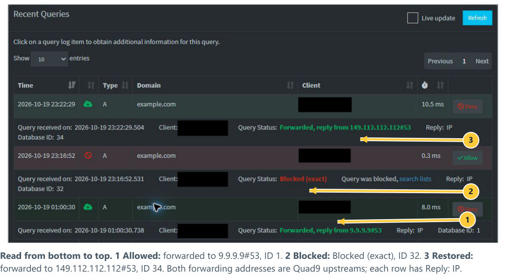

# HomeLab

I’m building a home IT lab with hardware I already own. I want useful services I can keep running, alongside practical experience with Linux, networking, automation and eventually cloud infrastructure.

The first working service is Pi-hole on a Raspberry Pi 4 that I administer over SSH. I verified an allowed request through Quad9, an exact deny returning `0.0.0.0` with `Blocked (exact)` in Query Log, and restored resolution after removing the test entries. These explicit desktop lookups left household DNS settings unchanged.

The active compute host is now a mini PC running Ubuntu Server. SSH after reboot, the Cockpit dashboard and Docker's test container are working. Coding-assistant CLIs are installed; authentication, project workloads and automatic task routing between PCs are next steps.

The evidence distinguishes captured output, reported actions and pending checks. Private identifiers are omitted from the project record.

## Explore the build

**Pi-hole and networking**

[](docs/pi-hole-project-report.md)
[](docs/pi-hole-project-report.pdf)
[](journal/2026-10-21-pihole-desktop-pilot.md)

**Mini PC foundation**

[](journal/2026-11-17-minipc-foundation.md)
[](evidence/images/minipc-host-baseline.png)
[](evidence/images/minipc-docker-check.png)
[](evidence/images/minipc-cli-versions.png)

## Current setup

```text
HomeLab roles on the shared household LAN
├── Desktop — administration, Windows applications and GPU work
├── Raspberry Pi 4 — Pi-hole DNS service
└── Mini PC — Ubuntu development and container host
```

The Pi has 8 GB of RAM and a 256 GB microSD card, based on my hardware inventory. The current AP setup shares the household LAN. It does not create an isolated lab network.

The Archer AX11000 remains an access point. The GL.iNet GL-X3000 Spitz AX remains available for future portable-lab work.

## Progress

| Milestone | Current result |
| --- | --- |
| Archer management access | Working at its connected management address |
| Desktop to Pi SSH login | Working |
| Pi account, hostname and OS identification | Terminal output captured |
| Pi initial software updates | Reported finished; full transaction output not captured |
| Pi SSH connection after the reboot step | Reported successful on 17 October; terminal capture shows uptime 17 minutes and SSH active |
| Pi root filesystem capacity | Capture shows `235G` total, `3.9G` used, `222G` available and `2%` used |
| Pi IPv4 route inspection | Ethernet default route and connected `/22` network captured |
| Stable device addresses | Pi and Archer reservations saved in Deco, user-confirmed; lease renewal not tested |
| Pi pre-install port inspection | Capture shows SSH on `22`; no listeners shown on `53`, `80` or `443` |
| Pi-hole installer download | Completed transfer captured; installation subsequently started |
| Pi-hole installation | Completed and admin password saved privately, user-reported; complete configuration has not been read back |
| Pi-hole dashboard | Login user-reported; subsequent Query Log and privacy controls browser-observed |
| Controlled-client DNS verification | **Allowed → blocked → restored**, verified across terminal captures and Query Log. The restored lookup returned public IPv4 answers; its log row shows `Forwarded` with a reply from Quad9 at `149.112.112.112#53`. |
| Query history troubleshooting | Level `3 — Anonymous mode` explained the empty Query Log. On 19 October Codex applied level `0`, reloaded and verified it persisted, with query-file logging enabled and Pi-hole Active. A subsequent allowed test query is now visible in Query Log. |
| Test-rule cleanup | A temporary Exact allow appeared alongside the Exact deny. Both test entries were deleted; learner capture and Codex's reloaded Domains view show zero entries. |
| Pi-hole configuration backup — 20 October | I exported and saved a private ZIP. Codex's read-only checks passed ZIP CRC, TOML parsing and both SQLite quick checks; the export has no temporary domain rules or query history. This is structural verification, not a tested restore. |
| Desktop-only Pi-hole pilot | Default Windows lookup and a controlled Chrome request reached Pi-hole; forwarding and cached answers captured. |
| Desktop DNS rollback and return — 11 November | Automatic Google DNS and the return to Pi-hole both resolved the test domain. On 12 November I reported that a usual website and ordinary app also worked. |
| Mini PC Ubuntu foundation — 17 November | Ubuntu 26.04.1 LTS, SSH after reboot and authenticated Cockpit dashboard captured. Hardware reported as Ryzen 5 5560U / 16 GB RAM. |
| Mini PC host-health baseline | Before Docker/CLI installation: 13 GiB available RAM, zero swap used, 424G available on `/`, Cockpit socket active and zero failed units listed. |
| Docker foundation | `hello-world` container succeeded; Docker Compose v5.8.0 captured. No project stack tested yet. |
| Coding-assistant tools | Codex CLI 0.170.0 and Claude Code 2.1.327 version checks passed. Sign-ins and workload resource use remain unverified. |
| Household DNS filtering | Not changed during this exercise; review privacy and recovery before any wider rollout |



The rows are newest first: **restored at the top, blocked in the middle, allowed at the bottom**. Private identifiers are removed from this selected proof image.

The configuration backup remains private, outside this project draft. It is not a complete Pi image or a backup of SSH, the operating system or router DHCP reservations. A restore test remains future work.

## Follow the build

Start with the [Pi-hole project report](docs/pi-hole-project-report.md) for the architecture, decisions, command explanations and verified DNS results. A [PDF version](docs/pi-hole-project-report.pdf) is available for download. The report uses selected sanitized evidence and credits the guidance behind this build.

The [build journal](journal/2026-10-16-pi-foundation.md) and [terminal evidence](evidence/2026-10-16-terminal-extract.md) preserve the detailed process. The [Pi foundation results](results/2026-10-17-pi-foundation.md) and [local recall page](results/pi-foundation.html) include short learning prompts. The longer illustrated personal guide stays outside this repository.

The [desktop DNS pilot journal](journal/2026-10-21-pihole-desktop-pilot.md) follows the next practical step: using Pi-hole from the desktop, checking Chrome, and practicing DNS rollback with selected sanitized evidence.

The [mini PC foundation journal](journal/2026-11-17-minipc-foundation.md) records the move to a dedicated Ubuntu compute host, its baseline checks, Docker verification and installed CLI versions. The next goal is to run Linux workloads on the mini PC while keeping desktop-specific actions on the desktop, then measure real resource use.

I’m doing this as a guided build, using Codex for explanations, troubleshooting assistance and documentation. The journal distinguishes my actions from the diagnostics Codex performed.
