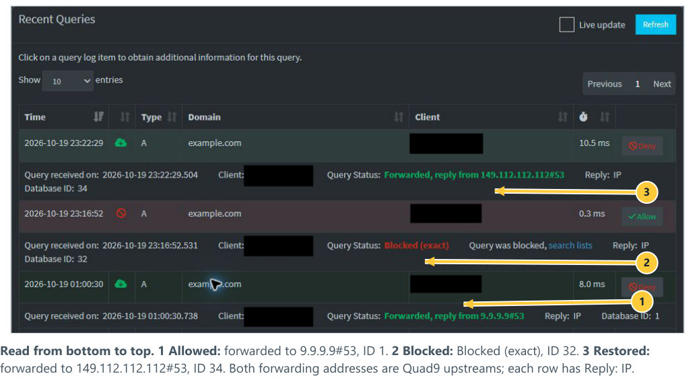

# Pi-hole DNS service project report

IT Homelab | Raspberry Pi 4 | 16-20 October 2026

## Purpose and result

I built a remotely managed Linux server from a Raspberry Pi 4 I already owned, then installed Pi-hole as the lab's first useful service. My goal was to understand a DNS request well enough to change its outcome, explain the result and return the service to its starting state.

The completed test was **allowed -> blocked -> restored**. A desktop lookup returned a normal IPv4 answer, an exact deny produced `0.0.0.0`, and removing the temporary entries restored resolution. Pi-hole's Query Log supplied the forwarding and blocking reasons alongside the client results. I also saved a private configuration export and had its structure checked; restoring it remains untested.

## Current architecture

```text
Home mesh and gateway
|-- Desktop: administration and explicit DNS tests
`-- TP-Link Archer AX11000: access point
    `-- Raspberry Pi 4: Ethernet, Linux, SSH and Pi-hole

Observed forwarded DNS path: Desktop -> Pi-hole -> Quad9 (external)
```

My hardware inventory lists 8 GB of RAM and a 256 GB microSD card for the Pi. The access point extends the household LAN; it does not isolate the lab. Each test explicitly selected the Pi as its DNS server. I left Windows' normal DNS configuration and household DNS settings unchanged.

The temporary domain rules used Pi-hole's Default group, so they were not inherently limited to the desktop. A future deployment needs deliberate client groups and privacy settings.

The observed interface versions were Pi-hole Core 6.5, FTL 6.8 and Web 6.6.1.

## Key choices

| Choice | Reason for this build |
| --- | --- |
| Raspberry Pi OS Lite and SSH | A terminal-based server fits the always-on service role and lets me administer the Pi from my desktop. |
| DHCP reservations | I saved reservations for the Pi and access point in Deco to keep their existing addresses. Lease renewal still needs a separate check. |
| Quad9 filtered DNSSEC without ECS | I selected the malicious-domain filtering service without the EDNS Client Subnet option. The allowed test rows show replies from Quad9's two public resolver addresses. |
| StevenBlack base list | I accepted one starting list so later exceptions and false positives will be easier to investigate. |
| Deliberate test domain | `example.com` let me demonstrate a local policy change without using a malicious domain or changing household DNS. |

<!-- pagebreak -->

## Establishing the Linux foundation

I used the following commands during the guided build. Commands in this section run **on the Pi through SSH**, except for the first connection command, which runs on the desktop. `YOUR_USER` and `YOUR_PI_IP` replace private account and address details; the examples are not a complete verbatim terminal transcript.

| Command | Purpose and observed result |
| --- | --- |
| `ssh YOUR_USER@YOUR_PI_IP` | Open an encrypted remote shell from the desktop. A successful login puts subsequent Linux commands on the Pi. I reconnected after the reboot step. |
| `whoami` and `hostname` | Check the account and target machine before making changes. Both identification commands returned the expected local labels. |
| `cat /etc/os-release` | Read the installed release information. The capture identifies Debian GNU/Linux 13, Trixie. |
| `sudo apt update` | Refresh APT's package catalogue with administrator privileges. It reported 14 available upgrades; this command does not install them. |
| `sudo apt full-upgrade` | Install updates and resolve dependency changes, which may remove packages. It finished and returned to the prompt; I did not keep the full output. |
| `sudo reboot` | Restart the Pi. The SSH connection closed, and I later opened a fresh connection. |
| `uptime` | Check time since boot and system load. The follow-up capture showed `up 17 min`. |
| `systemctl is-active ssh` | Ask systemd whether the SSH service is running. It returned `active`. |
| `df -h /` | Show root filesystem space in readable units. The capture showed `235G` total, `3.9G` used, `222G` available and `2%` used. This is capacity, not SD-card health. |
| `ip -4 route` | Inspect IPv4 routing. The default route used `eth0` and DHCP; the connected network had a `/22` prefix. |
| `sudo ss -lntup` | Inventory listening TCP/UDP sockets and their processes: `-l` listening, `-n` numeric, `-t` TCP, `-u` UDP, `-p` processes. SSH used port `22`; no listeners appeared on `53`, `80` or `443` before installation. |

## Downloading and starting Pi-hole

```bash
curl -fL -o basic-install.sh https://install.pi-hole.net
sudo bash basic-install.sh
```

`curl` downloads the official installer: `-f` fails on HTTP errors, `-L` follows redirects and `-o` names the saved file. The captured transfer reached 100%. `sudo bash` then runs that script with administrator privileges; downloading and executing it are separate actions. I completed the installer, saved the admin password privately and opened the web interface.

<!-- pagebreak -->

## Testing DNS behavior

From **Windows Command Prompt**, I used an explicit server argument:

```text
nslookup -type=A example.com YOUR_PI_IP
```

`nslookup` asks a DNS server for a record. `-type=A` requests IPv4 addresses, `example.com` is the name to resolve, and the final argument selects the Pi for this lookup. It does not make every desktop application use Pi-hole.

| Stage | Action and client result | Pi-hole result |
| --- | --- | --- |
| 1 Allowed | An initial desktop capture returned `172.66.147.243` and `104.20.23.154`. A later allowed request was inspected in Query Log. | `Forwarded`, reply from `9.9.9.9#53`. |
| 2 Blocked | I added an enabled Exact deny for `example.com` in Default and repeated the lookup. The client received `0.0.0.0`. | `Blocked (exact)`, confirming the local rule's reason. |
| 3 Restored | After removing both temporary domain entries, I repeated the lookup. Public IPv4 answers returned. | `Forwarded`, reply from `149.112.112.112#53`. |

The first terminal answer and later allowed log row are separate requests. The public answer addresses can change. Both forwarding addresses belong to Quad9; the timing values shown below are individual DNS responses, not Internet speed benchmarks.

Pi-hole's default NULL blocking mode returns the unspecified address `0.0.0.0` for a blocked A request, matching this result. NXDOMAIN is another reply mode that reports the name does not exist. Query Log's `Blocked (exact)` identifies the rule responsible.



**Figure 1.** Pi-hole lists the newest request first, so the exercise runs bottom to top. Private client identifiers were permanently removed before embedding.

<!-- pagebreak -->

## Troubleshooting lessons

### A working DNS answer can have an empty Query Log

The desktop received an answer, but Query Log was empty. The runtime privacy setting was **3, Anonymous mode**, even though query-file logging was enabled and the installer screenshot had shown level 0 selected. File logging and the history shown in Query Log are separate controls.

I tried saving level 0, but a reload still showed level 3. Codex applied **0, Show everything**, saved it and reloaded again to verify it persisted. A new test query then appeared. We did not establish why the earlier save failed. The useful habit is to verify the saved setting and generate a fresh event; changing privacy cannot recover earlier anonymous history.

### An allow override is different from removing a deny

A later Domains screenshot showed both Exact deny and Exact allow entries for `example.com`. Pi-hole gives an exact allow priority over an exact deny, so a successful answer with both present would not establish that the temporary configuration had been cleaned up.

I removed both entries. Codex reloaded Domains with all filters enabled and an empty search, confirming zero entries. I then repeated the lookup and received normal answers, with the restored request recorded as Forwarded. That sequence checked both configuration cleanup and the service outcome.

## Saving a private configuration backup

I used **Pi-hole > Settings > Teleporter > Export** and saved the archive outside the proposed GitHub files. Codex checked the saved ZIP read-only, without extracting files to disk or restoring configuration.

| Check | Result |
| --- | --- |
| ZIP integrity and paths | CRC passed; 5 members; no duplicate or unsafe paths. |
| Configuration | TOML parsed successfully. |
| Gravity and reduced FTL databases | Both SQLite `quick_check` results were `ok`, with expected configuration tables. |
| Test cleanup in the export | No temporary domain rules or query history were present. |
| Recovery | Restore not tested. |

This is a readable, structurally consistent configuration export. It can contain private network and authentication material, so the archive is excluded from this repository. It does not replace an operating-system image, SSH backups or the router's reservation records.

<!-- pagebreak -->

## What this build demonstrates

The useful result is a Linux-hosted DNS service I can administer remotely and test from a separate client. I practiced identifying the target machine, checking routes and listeners, separating a service response from its logging behavior, and reversing a temporary policy change. The test plan links each configuration change to a client result and a server-side reason.

This guided first build gives the larger IT homelab a working service baseline, a repeatable validation command and a recorded cleanup procedure.

## Next work

1. Plan and perform a recoverable backup restore test. The successful structure checks do not replace it.
2. Verify the address reservation after a DHCP lease renewal and record the result.
3. Review client groups, query retention and recovery procedures before routing ordinary household DNS through the Pi.
4. Add monitoring and maintenance practice before expanding into containers and the reused laptop. A separate lab network remains a later architecture change.

## Assistance and documentation

I performed the Pi setup, SSH commands, installer choices, desktop lookups, test-rule changes and export. Codex explained commands, assisted with troubleshooting, inspected selected browser results, applied the saved privacy correction and checked the archive. Codex also helped organize and edit this report. Claude reviewed the writing for clarity and technical wording; that review did not verify the hardware or repeat the lab tests.

My personal guide is private and contains additional annotated screenshots and recall prompts. This shorter project report uses one selected sanitized proof image. Raw captures, credentials, local identifiers and the configuration backup remain private.

## References

- [Raspberry Pi setup](https://www.raspberrypi.com/documentation/computers/getting-started.html) and [software updates](https://www.raspberrypi.com/documentation/computers/os.html#update-your-current-raspberry-pi-software).
- [OpenSSH client manual](https://man.openbsd.org/ssh.1), [curl manual](https://curl.se/docs/manpage.html) and [ss manual](https://man7.org/linux/man-pages/man8/ss.8.html).
- [Microsoft nslookup reference](https://learn.microsoft.com/en-us/windows-server/administration/windows-commands/nslookup).
- [Quad9 services](https://docs.quad9.net/services/) and [StevenBlack hosts list](https://github.com/StevenBlack/hosts).
- [Pi-hole privacy levels](https://docs.pi-hole.net/ftldns/privacylevels/), [configuration](https://docs.pi-hole.net/ftldns/configfile/), [domain rule priority](https://docs.pi-hole.net/database/domain-database/) and [blocking modes](https://docs.pi-hole.net/ftldns/blockingmode/).
- [Teleporter page source v6.6.1](https://github.com/pi-hole/web/blob/v6.6.1/settings-teleporter.lp) and [export implementation v6.8](https://github.com/pi-hole/FTL/blob/v6.8/src/zip/teleporter.c).
