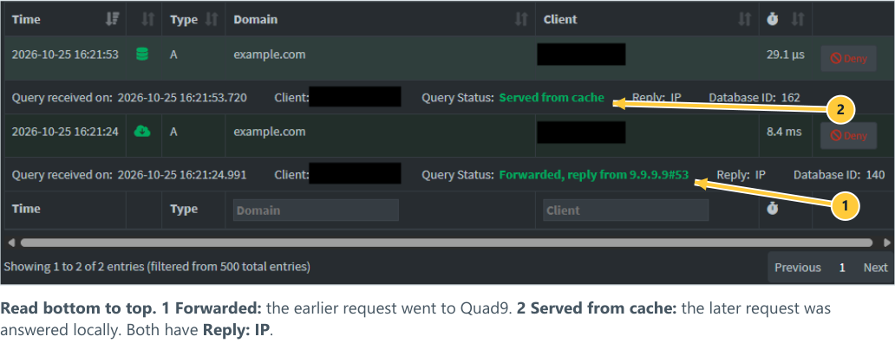
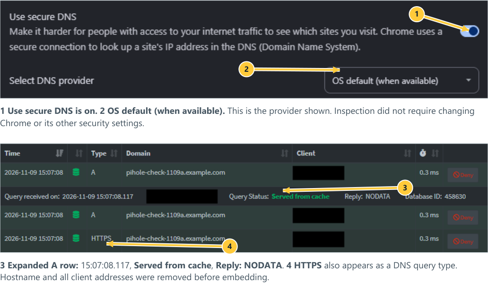
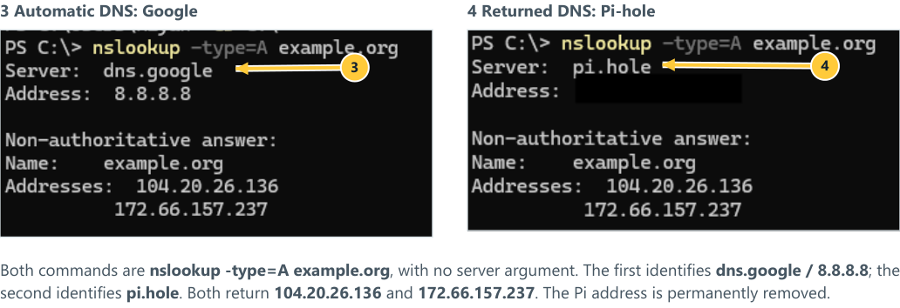

# Putting the Pi-hole service into use

21 October–12 November 2026 — desktop DNS pilot checkpoints recorded

I configured my desktop to select the existing Pi-hole service for DNS, then verified a lookup using the saved Windows settings. The client selected Pi-hole and received public IPv4 answers for `example.com`. The Query Log now records matching current-desktop requests handled by Quad9 forwarding and Pi-hole caching. A later controlled Chrome probe also reached Pi-hole. I then practiced restoring automatic desktop DNS and returning to Pi-hole; both default-resolver lookups succeeded. I also reported that a usual website and ordinary app worked on 12 November.

## Checking the running service — 21 October

At the Pi shell, `pihole status` reported FTL listening on port `53` over UDP and TCP for IPv4 and IPv6. It also warned that the protected `/etc/pihole/pihole.toml` could not be read and its values might not reflect the current configuration. I treated the blocking-enabled line as provisional.

I ran:

```bash
sudo pihole status
```

The warnings disappeared. The captured output reported the same DNS listeners and **Pi-hole blocking is enabled**. `sudo` gave that individual command the privileges needed to read the configuration; this check required no permission changes.

## Saving a baseline and changing desktop DNS — 25 October

My `Get-NetIPConfiguration` capture identified the connected Ethernet adapter and Google DNS servers `8.8.8.8` and `8.8.4.4`. Codex separately inspected the adapter read-only and saved the original automatic DNS mode privately for rollback. No IPv6 DNS servers were listed at that check.

I used **ncpa.cpl → Ethernet → Properties → Internet Protocol Version 4 → Properties** for the desktop-only pilot. Afterward, Codex's read-only check confirmed that the Pi was the adapter's only IPv4 DNS server, with no IPv6 DNS server listed. The settings dialog was not captured. The household router's DNS configuration was outside this change.

## Testing the saved DNS selection

From the desktop, I ran:

```powershell
nslookup -type=A example.com
```

There is no DNS-server address at the end. The command therefore uses the configured default server. The captured output identifies `pi.hole` at the Pi's address and returns `104.20.23.154` and `172.66.147.243` for `example.com`. These public answers can change. The local server address is omitted from shared evidence.

The earlier explicit-server lookups tested a deliberately selected resolver. This command also checks which default resolver the client selects after the configuration change. A successful DNS answer does not yet establish the browser's DNS path or application compatibility.

## Following the request in Query Log

The Query Log was busy after the desktop change. I used **Advanced filtering → Domain: example.com** to narrow the displayed results. The captured view shows two matching A requests, both already expanded:

| Time on 25 October | Query Status | Meaning | Displayed DNS response time |
| --- | --- | --- | --- |
| 16:21:24 | Forwarded, reply from `9.9.9.9#53` | Pi-hole forwarded the lookup to Quad9 and received an answer. `#53` is the upstream DNS port. | 8.4 ms |
| 16:21:53 | Served from cache | Pi-hole answered using its stored result. | 29.1 microseconds |



Both replies are type **IP**. Codex checked that the logged client matches my desktop's current address; private client fields are omitted from shared evidence. The client terminal capture has no timestamp, so I cannot uniquely assign that image to either individual log row. Together, the captures show a successful default-resolver lookup and current desktop queries reaching Pi-hole.

The right-hand **Deny** labels are available action buttons. Both captured statuses describe allowed handling. Filtering changes the view and preserves the history. The table reports two entries filtered from 500 total view entries; I have not measured the on-disk database size. The response times above are individual DNS measurements, not in-game ping or a performance benchmark.

## Checking Chrome with a controlled request — 9 November

I checked **Chrome → Settings → Privacy and security → Security → Use secure DNS**. The captured setting is **On**, with **OS default (when available)** selected. The setting alone does not tell me whether a particular request reached Pi-hole.

For the browser check, I used a recognizable test hostname:

```text
https://pihole-check-1109a.example.com/
```

The made-up hostname was intended to trigger an easy-to-identify DNS lookup. A browser error was expected, but I did not capture the browser error page as evidence. I filtered **Pi-hole → Query Log → Advanced filtering → Domain** to that hostname. The screenshot contains A and HTTPS DNS queries at displayed times 15:07:07–15:07:08 on 9 November.



The expanded A row at **15:07:08.117** says **Served from cache**, **Reply: NODATA**, with a displayed response time of **0.3 ms**. For that query, Pi-hole returned no IPv4 address record. Cached negative answers are valid DNS behavior; NODATA is distinct from NXDOMAIN and is not itself a blocking status. The screenshot does not show the initial upstream handling of this probe.

**HTTPS** in the Type column is a DNS record type requesting service information. It is not proof of a web connection or DNS-over-HTTPS transport. The 61 matching entries count DNS rows, not clicks or visited websites. The view count is not a disk-usage measurement.

Codex's current read-only check confirmed the logged client matches my desktop, with Pi-hole still the only configured IPv4 resolver and no IPv6 DNS server listed. No Chrome, adapter or blocking setting was changed by Codex. This is positive evidence that the controlled browser-triggered lookup reached Pi-hole; it does not establish coverage of every Chrome request, VPN or application, or DNS transport encryption.

## Practicing DNS rollback and returning to Pi-hole — 11 November

I used **ncpa.cpl → Ethernet → Properties → Internet Protocol Version 4 → Properties** to select **Obtain DNS server address automatically**. The captured dialog also shows IP addressing set to automatic. The dialog captures the selection; the following lookup checks the working default resolver:

```powershell
nslookup -type=A example.org
```

I supplied two terminal captures in sequence:

| DNS state | Default server shown | Public IPv4 answers |
| --- | --- | --- |
| Automatic DNS rollback | `dns.google`, `8.8.8.8` | `104.20.26.136`, `172.66.157.237` |
| Return to the Pi-hole pilot | `pi.hole`, private address omitted | `104.20.26.136`, `172.66.157.237` |



Neither command supplies a server argument, so the selected default resolver matters. `-type=A` requests IPv4 address records. Both resolvers returned answers for this ordinary allowed domain. The earlier allowed/blocked/restored exercise separately verified Pi-hole's filtering behavior.

The supplied sequence shows that I can switch this desktop back to its original automatic DNS mode and then use Pi-hole again. The terminal captures have no timestamps. I did not capture the restored manual-settings dialog; Codex separately checked the current adapter read-only and confirmed the Pi is its only configured IPv4 DNS server, with no IPv6 DNS server listed. Codex made no network-setting changes and did not run these learner commands.

This was a working DNS rollback exercise. It was not a real Pi outage, a full browser/application compatibility test, or a Pi-hole backup restore. Those are different checks.

## Checking ordinary use — 12 November

After returning to Pi-hole, I reported that a usual website and an ordinary app worked normally. This is my functional-use report; I did not supply screenshots, application names or timing measurements for this check. It adds a practical compatibility observation to the captured DNS tests, without claiming every application or VPN uses the same DNS path.

## Remaining checks and evidence limits

- Ordinary website/app use worked by my report. VPN behavior, universal application coverage and performance measurements remain untested.
- DNS rollback and return to Pi-hole are now captured. The desktop is currently configured to use Pi-hole again.
- A backup restore and a deliberate Pi DHCP lease-renewal check remain separate future work.

I ran the commands, selected the desktop DNS settings and supplied the captures. Codex interpreted results, performed the named read-only configuration checks and helped edit these notes. Original captures and the rollback record stay private; selected screenshots are permanently sanitized before guide use. No VM was created for this trial.

[Pi-hole command reference](https://docs.pi-hole.net/main/pihole-command/#status), [Microsoft network configuration](https://learn.microsoft.com/en-us/powershell/module/nettcpip/get-netipconfiguration?view=windowsserver2025-ps), [nslookup reference](https://learn.microsoft.com/en-us/windows-server/administration/windows-commands/nslookup), and [Pi-hole query status definitions](https://docs.pi-hole.net/database/query-database/#supported-status-types).

[Chrome Secure DNS settings](https://support.google.com/chrome/answer/10468685?co=GENIE.Platform%3DDesktop&hl=en), [negative DNS replies (RFC 2308)](https://www.rfc-editor.org/rfc/rfc2308.html), and [HTTPS DNS records (RFC 9460)](https://www.rfc-editor.org/rfc/rfc9460.html).
