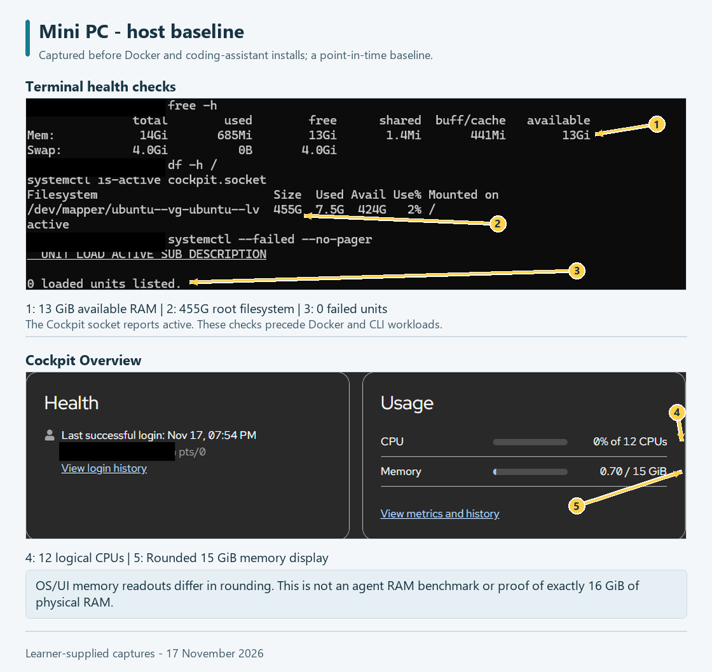
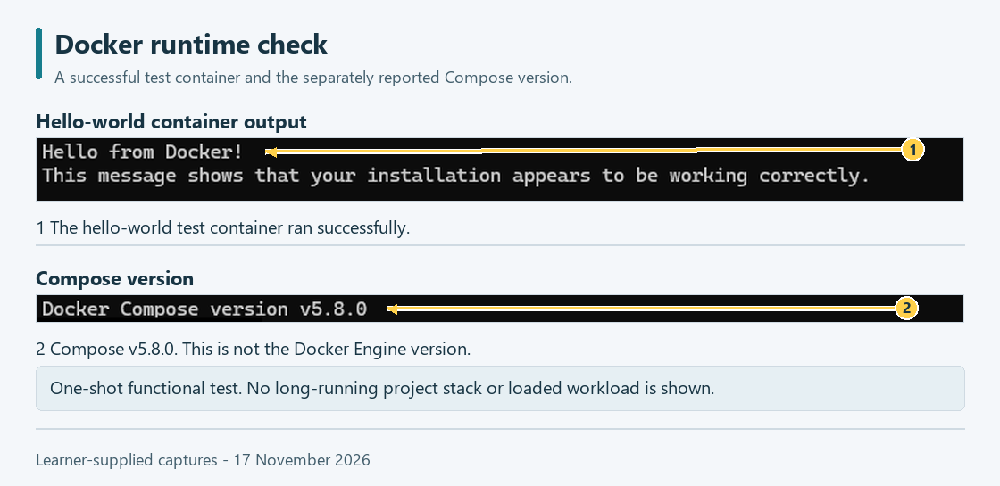
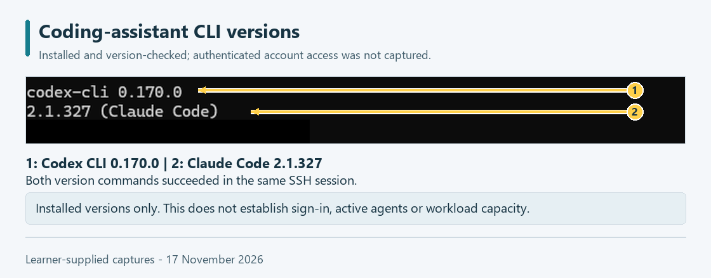

# A dedicated Ubuntu compute host

17 November 2026

I set up a mini PC as the active compute host, reported as a Ryzen 5 5560U with 16 GB RAM. The Pi keeps its separate Pi-hole role. My goal is a Linux host for builds, tests and containers that I can control from my desktop.

## Host setup and baseline

I installed Ubuntu Server 26.04.1 LTS, connected over SSH, rebooted and reconnected. I installed Cockpit for browser-based administration and captured its authenticated Overview page.

The initial update plan listed 48 upgrades and three packages deferred by phasing. A later login banner reported zero immediately available updates; I did not capture the full upgrade transaction.

Before installing Docker and the coding-assistant CLIs, I checked:

| Command | What it checks | Captured result |
| --- | --- | --- |
| `free -h` | Memory available to the host | 14 GiB rounded total; 685 MiB used; 13 GiB available; 4.0 GiB swap with 0 B used |
| `df -h /` | Space on the root filesystem | 455G total; 7.5G used; 424G available; 2% used |
| `systemctl is-active cockpit.socket` | Dashboard socket state | `active` |
| `systemctl --failed --no-pager` | Failed systemd units | Zero listed |



Cockpit displayed 12 logical CPUs and separately rounded memory as 0.70 / 15 GiB. These are host snapshots, not an AI workload benchmark or a long-duration reliability test. The root is LVM-backed; the exact SSD model and full partition layout were not captured.

## Docker and installed tools

Using [Docker's official Ubuntu repository](https://docs.docker.com/engine/install/ubuntu/), I installed the Engine packages and ran:

```bash
sudo docker run --rm hello-world
sudo docker compose version
```

`Hello from Docker!` confirms that Docker's test container ran successfully. Compose reported **v5.8.0**; that is the Compose version, and the Engine version was not captured. No application stack has been tested yet.



I also installed **Codex CLI 0.170.0** and **Claude Code 2.1.327**. Both version commands worked in the captured shell. A fresh SSH-session PATH check and account sign-ins are still pending.



## Lesson and next step

The execution location determines which computer supplies CPU and RAM. Sharing files alone does not move a running process. [VS Code Remote-SSH](https://code.visualstudio.com/docs/remote/ssh) is one possible way to control Linux development from the desktop while running remote tools on the mini PC.

I want one assistant workflow that routes Linux jobs to the mini PC and desktop-specific actions to the desktop. That coordination is a future requirement. After documenting this foundation, I will configure access and measure a small representative workload before increasing concurrency. Kubernetes remains future work.

I performed the server actions and supplied the captures. Codex helped explain the results, edit these notes and prepare selected evidence with identifying pixels permanently removed. Original captures and setup records stay private.
